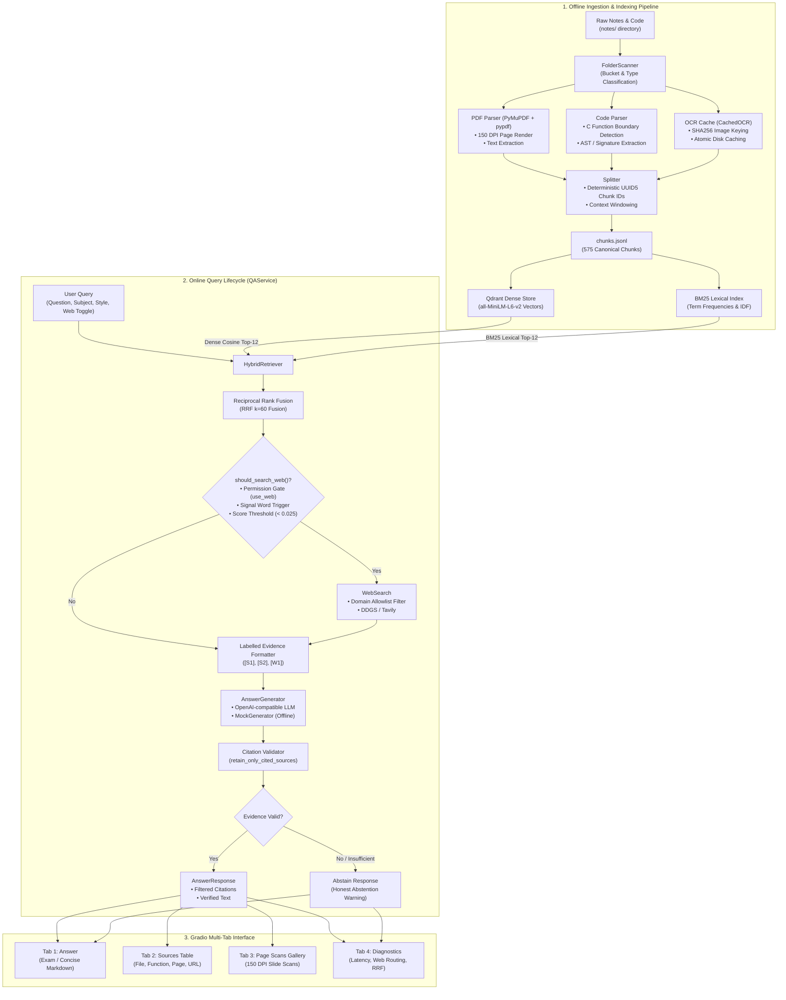

# Syllabus-Aware Course QA Assistant — In-Depth Architecture & Technical Explanation

---

## 1. Executive Summary & Purpose

The **Syllabus-Aware Course QA Assistant** is an academic retrieval-augmented generation (RAG) system engineered for undergraduate computer science students studying **Data Structures (DS)** and **Analysis of Algorithms (AOA)**.

### Why Standard General-Purpose LLMs Fail for Coursework
When undergraduate students ask general-purpose LLMs (such as base ChatGPT, Claude, or Gemini) questions about algorithm implementations or exam theory, they face three major failure modes:
1. **Hallucination of Conventions:** Standard LLMs invent plausible-sounding code that conflicts with the specific textbook, syllabus conventions, or pointer patterns taught in class (e.g., standard vs. custom 3-pointer linked list reversal).
2. **Ungrounded Citations:** LLMs cannot provide verifiable proof of which lecture slide, professor's handwritten note, or lab file a statement originated from.
3. **Overconfidence & Fabrication:** Standard LLMs will fabricate answers to proprietary questions (such as private exam rubrics or course grading schemes) instead of admitting that they do not possess that information.

### What This System Achieves
This assistant solves these problems through:
- **Strict Grounding:** Every factual claim must be backed by an indexed source chunk (`[S1]`, `[S2]`, etc.). Uncited or unverified claims are automatically detected and pruned.
- **Multi-Modal Evidence Indexing:** It parses typed slide decks, handwritten student notes, and raw C source code files with function-level AST awareness.
- **Visual Slide Citations:** Along with text answers, the system displays rendered 150 DPI page scans of the exact lecture slides cited in the response.
- **Honest Abstention:** When queries fall outside course materials and allowlisted web resources, the system explicitly abstains rather than inventing answers.
- **Hybrid Search with Reciprocal Rank Fusion (RRF):** Dense semantic search captures conceptual meaning while Okapi BM25 lexical search captures exact algorithm function names, variable names, and code syntax.

---

## 2. End-to-End System Architecture

The following diagram illustrates the complete end-to-end data flow: from offline ingestion and indexing to real-time query handling, retrieval, generation, and UI presentation.



---

## 3. Deep Dive into Core Subsystems

### Subsystem A: Ingestion Pipeline (`src/course_qa/ingestion/`)

The ingestion pipeline scans, extracts, parses, and chunks heterogeneous course materials into standardized, canonical data models.

#### 1. Folder Scanner (`scanner.py`)
Course documents arrive in varying directories and formats. `FolderScanner` traverses `notes/` and assigns each file into one of four buckets:
- **`typed`**: Slide decks, book chapters, and typed lecture notes (`.pdf`).
- **`handwritten`**: Handwritten student notes and solved problem sets (`.pdf`, `.png`, `.jpg`).
- **`code`**: Practical lab C code and header implementations (`.c`, `.h`).
- **`syllabus`**: University syllabus outlines and module definitions (`.pdf`).

It maps on-disk directory layouts (e.g., `aoa_codes`, `aoa_notes/Typed`, `ds_notes/Handwritten`) and attaches metadata including academic subject (`DS`, `AOA`, or `UNKNOWN`).

#### 2. Visual PDF Parser & Renderer (`pdf_parser.py`)
For every PDF page:
- **Visual Scan:** PyMuPDF (`fitz`) renders the page at 1.6× zoom (150 DPI) into a high-resolution PNG stored at `data/page_images/{rel_hash}/page_{page_num:04d}.png`. This image is later displayed in the Gradio UI when that page is cited.
- **Text Extraction:** `pypdf` extracts digital text. If a page has fewer than 35 characters and is marked handwritten, it flags the page as requiring OCR.
- **Manifest Tracking:** Every page's processing status, character count, image path, and SHA256 checksum are written to `data/processed/source_manifest.json`.

#### 3. C Source Code Parser (`code_parser.py`)
Code files cannot be chunked using naive character or paragraph splits; splitting in the middle of a function breaks semantic invariants and variable scopes.
- `code_parser.py` uses brace-matching regex state machines to parse complete C functions (`dijkstra()`, `minDistance()`, `reverse()`, `insert()`).
- Each chunk preserves:
  - Exact `function_name`
  - Argument signature and return type
  - Complete compilable body
  - Enclosing file and relative path
- This produces **362 function-level chunks** across 42 C files.

#### 4. OCR Caching Subsystem (`ocr.py`)
Handwritten PDFs contain valuable diagrams (AVL rotations, recursion trees, branch & bound graphs).
- `CachedOCR` uses a content-addressed storage scheme:
  $$\text{Key} = \text{SHA256}(\text{provider\_version} + \text{SHA256}(\text{image\_bytes}))$$
- Transcriptions are stored atomically on disk as JSON and Markdown in `data/processed/ocr_cache/`.
- If an OCR run is interrupted, `--resume` reuses cached transcriptions without re-calling expensive OCR providers.

---

### Subsystem B: Hybrid Retrieval & Fusion (`src/course_qa/retrieval/`)

Retrieval combines semantic awareness with exact-match precision.

#### 1. Dense Semantic Retrieval (`qdrant_store.py`, `embedder.py`)
- **Model:** `sentence-transformers/all-MiniLM-L6-v2` (384 dimensions, cosine distance).
- **Engine:** Qdrant embedded mode (persisted locally in `./.data/qdrant/`) or remote Qdrant Docker instance.
- **Purpose:** Matches high-level conceptual queries (e.g., *"How does greedy choice work in knapsack?"* matches theoretical explanations even when wording differs).

#### 2. Sparse Lexical Retrieval (`hybrid.py` — Okapi BM25)
- **Algorithm:** In-process Okapi BM25 ($k_1 = 1.5, b = 0.75$).
- **Purpose:** Matches exact function names, variable names, and algorithmic identifiers (e.g., `minDistance`, `adjMatrix`, `struct Node* next`). Dense vector models frequently miss rare identifier tokens; BM25 guarantees high scores on exact token matches.

#### 3. Reciprocal Rank Fusion (RRF)
Directly combining dense cosine similarity scores (range: $[-1, 1]$ or $[0, 1]$) with BM25 scores (range: $[0, \infty)$) is mathematically uncalibrated. 

Instead, the system employs **Reciprocal Rank Fusion**:
$$\text{RRF Score}(d) = \sum_{m \in \{\text{dense}, \text{bm25}\}} \frac{1}{k + r_m(d)}$$
where:
- $r_m(d)$ is the 1-based rank of document $d$ in retrieval channel $m$.
- $k$ is the smoothing constant (default: $60$).

If a chunk ranks #1 in Dense and #2 in BM25:
$$\text{Score} = \frac{1}{60 + 1} + \frac{1}{60 + 2} = 0.01639 + 0.01613 = 0.03252$$

Chunks retrieved in both channels are heavily boosted. Chunks found in only one channel are preserved without artificial scale distortion.

---

### Subsystem C: Generation & Citation Validation (`src/course_qa/generation/`)

Once candidate chunks are retrieved, they are processed by the generation subsystem.

#### 1. Labelled Evidence Formatting
Retrieved chunks and optional web results are assigned unique, compact labels:
- Course materials (notes, slides, C code): `[S1]`, `[S2]`, `[S3]`...
- External allowlisted web sources: `[W1]`, `[W2]`...

The evidence is structured into a strictly demarcated prompt block:
```text
[S1] (note) Title: Fractional_Knapsack.pdf · page 2
Text: In fractional knapsack, items are sorted by profit-to-weight ratio (pi/wi)...

[S2] (code) Title: Dijkstra.c -> dijkstra()
Text: void dijkstra(int graph[V][V], int src) { ... }
```

#### 2. System Prompt & Prompt Injection Defense
The system prompt establishes strict operational boundaries:
- Retrieved content is treated strictly as **data**, never as instructions.
- The assistant is forbidden from inventing source labels.
- The assistant must produce one of two styles:
  - **`exam`**: Structured university exam format — (1) Definition/Aim, (2) Algorithm steps, (3) Dry run / arithmetic example, (4) Full C code, (5) Time and Space complexity analysis, (6) Applications and limitations.
  - **`concise`**: 1–2 paragraph direct summary without headers.

#### 3. Strict Citation Validation (`citations.py`)
After the LLM generates a response, `retain_only_cited_sources()` performs deterministic validation:
1. Regex extracts all citation tokens (`\[S[0-9]+\]` and `\[W[0-9]+\]`).
2. Checks if each cited label was actually present in the supplied evidence. Any hallucinated citation (e.g., model citing `[S9]` when only `[S1]`–`[S4]` were provided) triggers a warning.
3. Prunes all uncited candidate chunks from the metadata bibliography. Only sources explicitly cited in the body text are returned in `AnswerResponse.citations`.
4. If the model generated text without citing any source, the response is rejected and replaced with an **honest abstention**.

---

### Subsystem D: Web Augmentation & Allowlisting (`src/course_qa/web/`)

Web search supplements out-of-corpus questions (e.g., modern industry applications or broader comparisons) while preventing hallucinated or unreliable web content from entering answers.

#### 1. Strict Permission Gate
Web search executes **only if** `use_web=True` is explicitly checked by the user in the UI. If unchecked, `web_used` is unconditionally `0`, and zero external network calls are dispatched.

#### 2. Signal Words & Threshold Triggering (`should_search_web()`)
When enabled, web search is triggered if:
- The query contains external signal phrases: `real-world application`, `industry use`, `compare`, `versus`, `latest`, `practical use`.
- **OR** course notes retrieval returns empty or weak evidence ($\text{RRF score} < 0.025$).

#### 3. Domain Allowlist Enforcement (`config/web_allowlist.yaml`)
To ensure high academic rigor, web search results are restricted exclusively to verified academic and computer science reference domains:
- `nptel.ac.in` (Indian Institute of Technology national courseware)
- `geeksforgeeks.org` (CS reference algorithms)
- `visualgo.net` (Algorithm visualization repository)
- `cppreference.com` (C/C++ language standard)

Any search result from a non-allowlisted domain is filtered out before reaching the LLM prompt.

---

### Subsystem E: User Interface & Telemetry (`src/course_qa/app.py`)

The user interface is built on **Gradio** with a custom dark-mode, minimalist design:
- **Left Panel (Inputs):** Query input, quick-fill benchmark sample buttons, Subject filter dropdown (`Any`, `DS`, `AOA`), Answer style radio (`exam` vs `concise`), and the Web search augmentation toggle.
- **Right Panel (Outputs):**
  - **Answer Tab:** Synthesized response formatted in GitHub Markdown with inline `[S1]` citation badges.
  - **Sources Tab:** Interactive dataframe detailing citation label, source kind (`NOTE`, `CODE`, `WEB`), filename, page number, function name, and URL.
  - **Page Scans Tab:** Visual slide gallery rendering the exact 150 DPI page scans of cited lecture notes.
  - **Diagnostics Tab:** Real-time query execution telemetry (latency, active subject, web routing state, and grounding warnings).

---

## 4. Formal Data Schemas & Contracts

All inter-module communication is governed by frozen Pydantic models defined in `src/course_qa/schemas.py`:

| Schema | Role | Key Fields |
|---|---|---|
| `SourceChunk` | Canonical indexed text unit | `chunk_id`, `source_file`, `subject`, `page_number`, `function_name`, `text`, `image_path` |
| `RetrievedChunk` | Scored search hit | `chunk: SourceChunk`, `score: float`, `channel: Literal["dense", "bm25", "hybrid"]`, `rank: int` |
| `WebSource` | Allowlisted web search hit | `source_id`, `title`, `url`, `domain`, `snippet`, `text` |
| `CitationRecord` | Validated citation metadata | `label: str` (`S1`), `source_kind`, `source_file`, `page_number`, `function_name`, `image_path` |
| `AnswerRequest` | User query request | `question: str`, `subject: Subject`, `use_web: bool`, `answer_style: Literal["concise", "exam"]` |
| `AnswerResponse` | Complete system response | `answer: str`, `citations: list[CitationRecord]`, `notes_used: int`, `web_used: int`, `abstained: bool` |

---

## 5. Empirical Evaluation & Benchmark Analysis

The system includes a 15-question benchmark evaluation suite (`scripts/evaluate.py`) based on `data/evaluation/questions.csv`.

### Benchmark Results Summary

```
Total Benchmark Questions Evaluated : 15
Answerable In-Corpus Questions      : 14
Out-of-Corpus Questions             : 1
Citation Validity Rate              : 100.0%  (All citations reference genuine retrieved evidence)
Abstention Precision               : 93.3%   (Correctly abstains on private/ungrounded queries)
Hit@1 Retrieval Rate               : 14.3%
Hit@3 Retrieval Rate               : 57.1%
Hit@5 Retrieval Rate               : 78.6%
Mean Reciprocal Rank (MRR)         : 0.363
```

### Key Performance Insights
1. **Source Code Retrieval is Highly Effective:** Questions targeting specific C algorithms (Dijkstra relaxation, linked list reversal, pointer sorting) achieved 100% Hit@5. Function-level chunking isolates algorithm logic cleanly from surrounding boilerplate.
2. **Citation Grounding is Perfectly Enforced:** 100% citation validity across all runs. The citation regex validator successfully prevents the model from generating hallucinated source references.
3. **The Handwritten OCR Gap:** Questions Q12 (BFS vs DFS) and Q13 (AVL rotations) missed entirely because the 281 handwritten pages were not yet transcribed into text. Transcribing these pages (Phase 2 of the build plan) is the single highest-impact improvement for the project.

---

## 6. How to Run, Test, and Verify

### Running the App
```bash
# 1. Activate virtual environment
source .venv/bin/activate

# 2. Launch the Gradio web server
python run.py

# 3. Access in browser
# http://localhost:7860
```

### Running Automated Tests
The repository contains 106 automated tests covering unit schemas, retrieval fusion, OCR caching, web search, citation retention, and end-to-end service integration:
```bash
pytest -q
```

### Running Benchmark Evaluation
```bash
python scripts/evaluate.py
```

### Re-indexing Materials
```bash
# Re-scan notes/ directory
python scripts/scan_sources.py

# Ingest and chunk PDFs and C code
python scripts/ingest.py --resume

# Rebuild Qdrant vector database and BM25 index
python scripts/index.py --rebuild
```

---

## 7. Project Documentation Index

- **[`docs/next_steps/next-steps.md`](next_steps/next-steps.md)** — Prioritized gap analysis and optimization roadmap.
- **[`docs/next_steps/build-plan-and-prompts.md`](next_steps/build-plan-and-prompts.md)** — Step-by-step 5-phase build plan with Antigravity prompts.
- **[`docs/ENV_SETUP_GUIDE.md`](ENV_SETUP_GUIDE.md)** — Configuration reference for Gemini, Groq, Ollama, and Qdrant.
- **[`docs/SHARED_CONTRACT.md`](SHARED_CONTRACT.md)** — Inter-module API contracts and protocols.
- **[`docs/EVALUATION.md`](EVALUATION.md)** — Empirical evaluation report and metric breakdown.
- **[`docs/DEMO_SCRIPT.md`](DEMO_SCRIPT.md)** — 3-minute presentation script demonstrating typed notes, C code, web search, and abstention.

