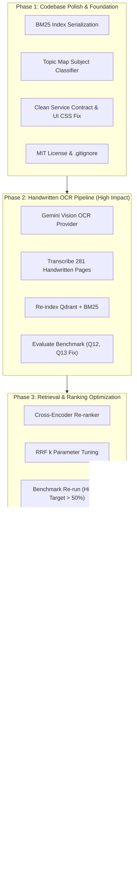

# Syllabus RAG Assistant — Master Build Plan & Execution Prompts

This build plan is divided into 5 progressive phases. Each phase is self-contained, includes the architectural blueprint, and provides a **ready-to-paste prompt** engineered specifically for Antigravity.

> [!IMPORTANT]
> Each prompt is grounded against the actual current codebase. File paths, class names, method signatures, schema Literals, and existing config fields have been verified against the source code as of 2026-11-03.

---

## 🗺️ Build Roadmap Overview



---

## Phase 1: Codebase Polish & Foundation

### Objective
Resolve all inconsistencies, unused assets, and architectural rough edges before adding new subsystems:
1. **BM25 Persistence**: Save and load the BM25 index from `data/index/bm25.json` rather than re-computing all token frequencies in-memory on every single service boot.
2. **Topic Map Integration**: Wire `config/topic_map.yaml` into a lightweight keyword matcher in `service.py` to auto-detect subject (`DS` vs `AOA`) when the user selects "Any".
3. **QAService Clean Contract**: Eliminate monkey-patching of `_boot_warnings`, `_chunks_count`, and `_embedder_dim` on `QAService` instances in `app.py`.
4. **Gradio CSS & Offline Fallback**: Apply `CLEAN_CSS` directly inside `gr.Blocks(css=CLEAN_CSS)` and provide system font fallbacks if Google Fonts cannot load offline.
5. **Missing License & .gitignore**: Add standard MIT `LICENSE` file and verify `.gitignore` covers `.env`, `data/page_images/`, `data/processed/chunks.jsonl`, and `.data/qdrant/`.

---

### Phase 1 Prompt (Copy-Paste into Antigravity)

```markdown
Please implement Phase 1: Codebase Polish & Foundation for the syllabus-rag-assistant project.

IMPORTANT: Read each target file before modifying it. Preserve all existing functionality and tests.

## Codebase Context
- `Settings` in `src/course_qa/config.py` is a frozen dataclass with `bm25_index_path: Path` already defined (line 37, default `./data/index/bm25.json`). The field exists but is NEVER read or written by any code.
- `BM25Index` in `src/course_qa/retrieval/hybrid.py` has internal fields: `documents` (list[list[str]]), `k1`, `b`, `term_counts` (list[Counter]), `lengths` (list[int]), `n` (int), `avgdl` (float), `idf` (dict[str,float]).
- `HybridRetriever.__init__` builds `BM25Index` in-memory on every instantiation from chunks.
- `QAService` in `src/course_qa/service.py` is a plain class (NOT a dataclass) with `__init__(self, notes_retriever, generator, web_searcher)`.
- In `src/course_qa/app.py` (lines 175-177), attributes `_boot_warnings`, `_chunks_count`, and `_embedder_dim` are monkey-patched onto the `QAService` instance after construction.
- `config/topic_map.yaml` contains keyword lists mapping topics to DS and AOA subjects. This file exists but is never imported or used.
- `Subject = Literal["DS", "AOA", "UNKNOWN"]` is defined in `src/course_qa/schemas.py`.
- The `CLEAN_CSS` string is defined at module level in `app.py` but is only passed via `demo.launch(css=CLEAN_CSS)` inside `main()`, NOT inside `build_ui()`.

## Target Files to Modify
- `src/course_qa/retrieval/hybrid.py` — BM25 serialization
- `src/course_qa/app.py` — load BM25 from disk, fix CSS, fix monkey-patching
- `scripts/index.py` — save BM25 after indexing
- `src/course_qa/service.py` — topic map integration, clean constructor
- `tests/test_hybrid.py` — test BM25 save/load roundtrip
- `tests/test_service.py` — test topic detection
- `LICENSE` — new file
- `.gitignore` — verify entries

## Tasks

### 1. BM25 Index Persistence
In `src/course_qa/retrieval/hybrid.py`:
- Add a `save_bm25_index(index: BM25Index, chunks: list[SourceChunk], path: Path)` function that serializes the BM25 state to JSON. Save: `k1`, `b`, the pre-tokenized `documents` (list of token lists), and the list of `chunk_id`s so we can verify the index matches the current corpus.
- Add a `load_bm25_index(path: Path, chunks: list[SourceChunk]) -> BM25Index | None` function. Load the JSON, verify the stored chunk_id list matches the current chunks (return None on mismatch so we fall back to recomputing). Reconstruct `BM25Index` from the saved token lists.

In `scripts/index.py`:
- After Qdrant indexing completes, import `save_bm25_index`, `tokenize` and `BM25Index` from `hybrid.py`.
- Build the BM25 index from chunks and save it to `settings.bm25_index_path`.
- Print a confirmation: `"BM25 index saved to {path} ({n} documents)"`.

In `src/course_qa/app.py` (`build_service()`):
- After loading chunks, check if `settings.bm25_index_path` exists. If so, call `load_bm25_index()`. If it returns a valid index, pass it to `HybridRetriever`.
- Modify `HybridRetriever.__init__` to accept an optional `bm25: BM25Index | None = None` parameter. If provided, use it instead of rebuilding from scratch.

### 2. Topic Map Subject Classifier
In `src/course_qa/service.py`:
- At module level, load `config/topic_map.yaml` using PyYAML (already in requirements.txt). Use a try/except so the system works even if the file is missing.
- Add function `detect_subject(query: str) -> str | None` that lowercases the query and checks if any topic keyword from the YAML appears as a substring. If a DS topic matches, return `"DS"`. If an AOA topic matches, return `"AOA"`. If both or neither match, return `None` (don't filter).
- In `QAService.answer()`, BEFORE calling `self.notes_retriever.retrieve()`: if `request.subject is None`, call `detect_subject(request.question)` and use the result as the subject filter. If `detect_subject` returns None, pass `subject=None` (no filter).

### 3. Clean QAService Contract
In `src/course_qa/service.py`:
- Add `boot_warnings`, `chunks_count`, and `embedder_dim` as regular constructor parameters with defaults:
  ```python
  def __init__(self, notes_retriever, generator, web_searcher,
               *, boot_warnings: list[str] | None = None,
               chunks_count: int = 0, embedder_dim: int = 0) -> None:
      self.notes_retriever = notes_retriever
      self.generator = generator
      self.web_searcher = web_searcher
      self.boot_warnings = boot_warnings or []
      self.chunks_count = chunks_count
      self.embedder_dim = embedder_dim
  ```

In `src/course_qa/app.py`:
- Remove the 3 monkey-patching lines (175-177). Instead pass the values into the `QAService` constructor:
  ```python
  service = QAService(retriever, generator, web, boot_warnings=warnings,
                      chunks_count=len(chunks), embedder_dim=embedder.dimension)
  ```
- Update the `respond()` function references from `service._boot_warnings` to `service.boot_warnings`.

### 4. Gradio CSS & Offline Font Safety
In `src/course_qa/app.py`:
- Change `gr.Blocks(title="Course QA Assistant")` to `gr.Blocks(title="Course QA Assistant", css=CLEAN_CSS, theme=gr.themes.Base())`.
- Remove `css=CLEAN_CSS` and `theme=gr.themes.Base()` from `demo.launch()` in `main()` (it's now on the Blocks constructor).
- In the `CLEAN_CSS` string, update the `font-family` declarations to include system fallbacks AFTER the Google Fonts:
  `font-family: 'Inter', -apple-system, BlinkMacSystemFont, 'Segoe UI', Roboto, Helvetica, Arial, sans-serif !important;`

### 5. MIT LICENSE & .gitignore
- Create `LICENSE` with standard MIT License text, copyright year 2026, holder "Ashman Raut".
- Verify `.gitignore` includes: `.env`, `data/page_images/`, `data/processed/chunks.jsonl`, `data/processed/ocr_cache/`, `.data/`, `data/index/bm25.json`, `*.pyc`, `__pycache__/`, `.pytest_cache/`. Add any missing entries.

### 6. Testing
- In `tests/test_hybrid.py`, add a test that creates a small BM25 index, saves it with `save_bm25_index`, loads it with `load_bm25_index`, and verifies scores match the original.
- In `tests/test_service.py`, add a test for `detect_subject()` verifying: "Dijkstra" → "AOA", "linked list" → "DS", "hello world" → None.
- Run `pytest -q` and ensure all existing and new tests pass.
```

---

## Phase 2: Handwritten Notes OCR via Gemini Vision

### Objective
Fix the single biggest cause of retrieval failure (**Hit@3 = 57.1%**, misses on Q12 and Q13). Transcribe the **281 handwritten pages across 22 PDFs** currently stalled in `pending` OCR state.

Because the repository already has a working Gemini API key configured in `.env`, we will implement `GeminiVisionOCRProvider` implementing the `OCRProvider` protocol in `src/course_qa/ingestion/ocr.py`. It integrates seamlessly with `CachedOCR`'s existing atomic SHA256 caching and manifest tracking.

---

### Phase 2 Prompt (Copy-Paste into Antigravity)

```markdown
Please implement Phase 2: Handwritten Notes OCR via Gemini Vision for the syllabus-rag-assistant project.

IMPORTANT: Read each target file before modifying it. Preserve all existing functionality and tests.

## Codebase Context
- `OCRProvider` protocol in `src/course_qa/ingestion/ocr.py` requires: `provider_version: str` attribute and `def transcribe(self, image_path: Path) -> str` method.
- `CachedOCR` wraps any `OCRProvider` with SHA256 content-addressed caching at `data/processed/ocr_cache/`. It caches atomically (write to `.tmp`, then rename). Empty transcriptions are NOT cached so retries work.
- `PaddleOCRVLProvider` already exists in `ocr.py` as a reference implementation (lines 54-100).
- `create_ocr_provider()` in `src/course_qa/ingestion/runner.py` (line 14) currently only handles `paddleocr_vl`/`paddleocr-vl`/`paddleocr` and returns `None` for everything else.
- `settings.ocr_provider` ALREADY EXISTS in `src/course_qa/config.py` (line 32): `ocr_provider: str = os.getenv("OCR_PROVIDER", "disabled")`.
- `settings.llm_api_key` and `settings.llm_base_url` contain the Gemini API credentials. The `openai` SDK is already in `requirements.txt`.
- `settings.llm_model` currently defaults to `gemini-3.5-flash`.
- `scripts/ingest.py` ALREADY has `--resume` and `--max-ocr-pages` CLI flags (lines 6-8).
- `pdf_parser.py` renders each page as a 150 DPI PNG at `data/page_images/{hash}/page_{num:04d}.png`. These images are what the OCR provider will transcribe.
- 281 handwritten pages across 22 PDFs currently have `ocr_status="pending"` in the source manifest.

## Target Files to Modify
- `src/course_qa/ingestion/ocr.py` — add GeminiVisionOCRProvider
- `src/course_qa/ingestion/runner.py` — wire new provider into factory
- `.env.example` — add `gemini_vision` as a documented OCR_PROVIDER option
- `tests/test_ocr_cache.py` — add unit test for new provider

## Tasks

### 1. Implement GeminiVisionOCRProvider in `src/course_qa/ingestion/ocr.py`
Add a new class after `PaddleOCRVLProvider`:

```python
class GeminiVisionOCRProvider:
    """OCR via Gemini Vision API using the OpenAI-compatible SDK."""

    def __init__(self) -> None:
        from openai import OpenAI
        from ..config import settings

        if not settings.llm_api_key:
            raise RuntimeError(
                "OCR_PROVIDER=gemini_vision requires LLM_API_KEY to be set in .env"
            )
        self.client = OpenAI(
            api_key=settings.llm_api_key,
            base_url=settings.llm_base_url or None,
            timeout=60.0,
            max_retries=2,
        )
        self.model = settings.llm_model or "gemini-2.5-flash"
        self.provider_version = f"gemini-vision-v1:{self.model}"

    def transcribe(self, image_path: Path) -> str:
        import base64
        import time

        img_bytes = image_path.read_bytes()
        suffix = image_path.suffix.lower().lstrip(".")
        mime = {"png": "image/png", "jpg": "image/jpeg", "jpeg": "image/jpeg",
                "webp": "image/webp", "tif": "image/tiff", "tiff": "image/tiff"}.get(suffix, "image/png")
        b64 = base64.b64encode(img_bytes).decode("ascii")

        prompt = (
            "Transcribe this handwritten academic computer science note page into clean, "
            "accurate Markdown. Preserve all algorithm steps, pseudocode, C code blocks "
            "(use ```c fences), mathematical notations (use LaTeX $...$), tree/graph "
            "diagram structures (describe them textually), and comparison tables "
            "(use Markdown tables). Output ONLY the transcribed content without "
            "introductory remarks or commentary."
        )

        for attempt in range(3):
            try:
                response = self.client.chat.completions.create(
                    model=self.model,
                    max_tokens=4096,
                    messages=[{
                        "role": "user",
                        "content": [
                            {"type": "text", "text": prompt},
                            {"type": "image_url", "image_url": {
                                "url": f"data:{mime};base64,{b64}"
                            }},
                        ],
                    }],
                )
                return (response.choices[0].message.content or "").strip()
            except Exception as exc:
                if "429" in str(exc) or "rate" in str(exc).lower():
                    wait = 2 ** attempt * 5
                    time.sleep(wait)
                    continue
                raise
        return ""
```

### 2. Wire Provider into `runner.py`
In `src/course_qa/ingestion/runner.py`, update `create_ocr_provider()`:
- Add a branch: if `settings.ocr_provider.lower() in {"gemini_vision", "gemini-vision", "gemini", "vision"}`, import and instantiate `GeminiVisionOCRProvider`, wrap in `CachedOCR`.
- Update the import line at top of file to include `GeminiVisionOCRProvider`:
  ```python
  from .ocr import CachedOCR, PaddleOCRVLProvider, GeminiVisionOCRProvider
  ```
- The function should return `CachedOCR(GeminiVisionOCRProvider(), settings.ocr_cache_dir)`.

### 3. Update `.env.example`
In the `# ── OCR ──` section, update the `OCR_PROVIDER` comment to show the new option:
```
OCR_PROVIDER=disabled         # disabled | paddleocr_vl | gemini_vision
```

### 4. Testing
In `tests/test_ocr_cache.py`:
- Add a test that mocks `GeminiVisionOCRProvider.transcribe` to return sample text, wraps it in `CachedOCR`, and verifies:
  1. First call triggers the provider and creates a cache file.
  2. Second call returns cached text without calling the provider again.
  3. `is_cached()` returns True after the first transcription.
- Run `pytest -q` and ensure all tests pass.

### 5. After implementation, test with a pilot run
Do NOT actually run this (it requires network + API key), but document the command:
```bash
# Set OCR_PROVIDER=gemini_vision in .env, then:
python scripts/ingest.py --resume --max-ocr-pages 5
# Then re-index:
python scripts/index.py --rebuild
# Then re-evaluate:
python scripts/evaluate.py
```
```

---

## Phase 3: Retrieval & Ranking Optimization (Cross-Encoder Re-ranker)

### Objective
Improve **Hit@1 (14.3%)** and **MRR (0.363)** to production-grade benchmarks (Hit@1 > 50%, MRR > 0.65).

Current hybrid retrieval fuses top-12 Dense and top-12 BM25 hits with Reciprocal Rank Fusion (RRF k=60). While RRF merges different score distributions well, it lacks cross-attention semantics between the query and candidate documents. Adding an optional fast Cross-Encoder re-ranker (`cross-encoder/ms-marco-MiniLM-L-6-v2`) will dramatically sharpen rank ordering.

---

### Phase 3 Prompt (Copy-Paste into Antigravity)

```markdown
Please implement Phase 3: Cross-Encoder Re-ranker & Retrieval Optimization for syllabus-rag-assistant.

IMPORTANT: Read each target file before modifying it. Preserve all existing functionality and tests.

## Codebase Context
- `RetrievedChunk` in `src/course_qa/schemas.py` has `channel: Literal["dense", "bm25", "hybrid"]`. Adding "reranked" requires updating this Literal.
- `HybridRetriever` in `src/course_qa/retrieval/hybrid.py` takes `(chunks, embedder, store)` in `__init__` and has a single `retrieve()` method.
- `settings.rrf_k` ALREADY EXISTS in `src/course_qa/config.py` (line 21), currently defaulting to 60.
- `sentence-transformers>=3.0` is already in `requirements.txt`, which includes `CrossEncoder` support.
- `SentenceTransformerEmbedder` in `embedder.py` uses lazy import of `sentence_transformers`.
- `app.py`'s `build_service()` constructs `HybridRetriever(chunks, embedder, store)`.
- `contracts.py` defines `NotesRetriever` protocol with `def retrieve(self, question: str, *, subject: str | None = None, top_k: int = 5) -> list[RetrievedChunk]`.

## Target Files to Modify
- `src/course_qa/schemas.py` — update RetrievedChunk channel Literal
- `src/course_qa/config.py` — add reranker settings, update RRF_K default
- `src/course_qa/retrieval/reranker.py` — new file
- `src/course_qa/retrieval/hybrid.py` — integrate reranker into retrieve()
- `src/course_qa/app.py` — instantiate reranker in build_service()
- `requirements.txt` — no change needed (sentence-transformers already present)
- `tests/test_hybrid.py` — test reranker

## Tasks

### 1. Update Schema
In `src/course_qa/schemas.py`, change the `RetrievedChunk.channel` field from:
```python
channel: Literal["dense", "bm25", "hybrid"]
```
to:
```python
channel: Literal["dense", "bm25", "hybrid", "reranked"]
```

### 2. Configuration Settings
In `src/course_qa/config.py`, add these fields to the `Settings` dataclass:
```python
use_reranker: bool = os.getenv("USE_RERANKER", "true").lower() == "true"
reranker_model: str = os.getenv("RERANKER_MODEL", "cross-encoder/ms-marco-MiniLM-L-6-v2")
rerank_top_k: int = int(os.getenv("RERANK_TOP_K", "15"))
```
Also update the default for `rrf_k` from `"60"` to `"20"` for sharper rank weighting:
```python
rrf_k: int = int(os.getenv("RRF_K", "20"))
```

### 3. Implement CrossEncoderReranker
Create `src/course_qa/retrieval/reranker.py`:
```python
from __future__ import annotations
from typing import Protocol
from ..schemas import RetrievedChunk

class Reranker(Protocol):
    def rerank(self, query: str, candidates: list[RetrievedChunk], top_k: int) -> list[RetrievedChunk]: ...

class CrossEncoderReranker:
    """Lazy-loaded cross-encoder reranker using sentence-transformers."""

    def __init__(self, model_name: str) -> None:
        self._model_name = model_name
        self._model = None  # lazy load

    def _ensure_loaded(self) -> None:
        if self._model is None:
            from sentence_transformers import CrossEncoder
            self._model = CrossEncoder(self._model_name)

    def rerank(self, query: str, candidates: list[RetrievedChunk], top_k: int) -> list[RetrievedChunk]:
        if not candidates:
            return []
        self._ensure_loaded()
        pairs = [(query, c.chunk.text) for c in candidates]
        raw_scores = self._model.predict(pairs)

        # Normalize scores to [0, 1] using min-max
        min_s, max_s = float(min(raw_scores)), float(max(raw_scores))
        span = max_s - min_s if max_s > min_s else 1.0
        normalized = [(float(s) - min_s) / span for s in raw_scores]

        scored = sorted(zip(candidates, normalized), key=lambda x: x[1], reverse=True)
        return [
            RetrievedChunk(chunk=c.chunk, score=s, channel="reranked", rank=i)
            for i, (c, s) in enumerate(scored[:top_k], start=1)
        ]
```

### 4. Integrate into HybridRetriever
In `src/course_qa/retrieval/hybrid.py`:
- Add `reranker=None` parameter to `HybridRetriever.__init__` and store as `self.reranker`.
- At the end of `retrieve()`, AFTER RRF fusion produces `ordered`, if `self.reranker is not None`:
  1. Take the top `settings.rerank_top_k` RRF candidates (instead of `top_k`).
  2. Pass them through `self.reranker.rerank(question, candidates, top_k)`.
  3. Return the reranked results.
- If `self.reranker is None`, return the existing RRF results as before (no behavior change).

### 5. Wire in app.py
In `src/course_qa/app.py` `build_service()`, after creating the embedder:
```python
reranker = None
if settings.use_reranker:
    from .retrieval.reranker import CrossEncoderReranker
    reranker = CrossEncoderReranker(settings.reranker_model)
```
Pass `reranker` to `HybridRetriever(chunks, embedder, store, reranker=reranker)`.

### 6. Update .env.example
Add these entries:
```
USE_RERANKER=true
RERANKER_MODEL=cross-encoder/ms-marco-MiniLM-L-6-v2
RERANK_TOP_K=15
```
Update `RRF_K=20` (changed from 60).

### 7. Testing
In `tests/test_hybrid.py`:
- Add a test that creates a `CrossEncoderReranker` with a mock model (patch `sentence_transformers.CrossEncoder` to return fixed scores).
- Verify that calling `rerank()` re-sorts candidates by the mock scores and assigns `channel="reranked"` and sequential ranks.
- Verify that an empty candidate list returns `[]`.
- Run `pytest -q` and ensure all existing and new tests pass.
```

---

## Phase 4: Real-Time Token Streaming & Evidence Inspector UI

### Objective
Transform the Gradio interface from a static waiting screen into a reactive, professional developer experience:
1. **Streaming Generation**: Token-by-token streaming in the Answer tab so users don't wait 4–8 seconds in silence.
2. **Evidence Inspector**: A dedicated diagnostic view showing exact candidate scores (Dense cosine, BM25 TF-IDF, RRF score, Re-ranker probability) before generation.
3. **Export Answer**: A single-click button to download the synthesized answer and formatted citation bibliography as a `.md` file.

---

### Phase 4 Prompt (Copy-Paste into Antigravity)

```markdown
Please implement Phase 4: Real-Time Token Streaming & Evidence Inspector UI for syllabus-rag-assistant.

IMPORTANT: Read each target file before modifying it. Preserve all existing functionality and tests.

## Codebase Context
- `OpenAICompatibleGenerator` in `src/course_qa/generation/generator.py` uses `self.client.chat.completions.create(**call_kwargs)` (line 164). The OpenAI SDK supports `stream=True` which returns an iterator of `ChatCompletionChunk` objects.
- `MockGenerator.generate()` returns a complete `AnswerResponse` synchronously. The streaming version should yield the full mock answer in a single chunk.
- `retain_only_cited_sources(raw, records)` in `citations.py` takes the complete answer text and returns `(cleaned_answer, used_records, warnings)`. Citation validation can only run after the full response is assembled.
- `build_labelled_evidence(notes, web)` returns `(context_str, records)`.
- The Gradio `respond()` function in `app.py` currently returns a 5-tuple: `(answer_md, source_rows, warnings_md, images, telemetry_md)`. It's bound to `submit.click()`.
- Gradio supports generator functions for streaming: if `respond` is a generator that `yield`s tuples, Gradio progressively updates all output components.
- `AnswerResponse` model in `schemas.py` is the canonical response object.
- The existing 4-tab layout: Answer, Sources, Page Scans, Diagnostics.

## Target Files to Modify
- `src/course_qa/generation/generator.py` — add `generate_stream()` method
- `src/course_qa/service.py` — add `answer_stream()` method
- `src/course_qa/app.py` — streaming UI, evidence inspector tab, export button
- `tests/test_service.py` — test streaming

## Tasks

### 1. Streaming Generator Methods
In `src/course_qa/generation/generator.py`:

Add `generate_stream()` to `OpenAICompatibleGenerator`:
```python
from collections.abc import Iterator

def generate_stream(
    self,
    request: AnswerRequest,
    notes: Sequence[RetrievedChunk],
    web: Sequence[WebSource],
) -> Iterator[AnswerResponse]:
    context, records = build_labelled_evidence(list(notes), list(web))
    if not records:
        yield _abstain_response()
        return

    # Build the same prompt as generate()
    # ... (reuse the style/subject/user_prompt logic from generate())

    call_kwargs["stream"] = True
    stream = self.client.chat.completions.create(**call_kwargs)

    accumulated = ""
    for chunk in stream:
        delta = chunk.choices[0].delta.content or ""
        accumulated += delta
        # Yield partial response (citations not yet validated)
        yield AnswerResponse(
            answer=accumulated, citations=[], notes_used=0, web_used=0,
            abstained=False, warnings=["Streaming — citations pending..."],
        )

    # Final yield with validated citations
    answer, used_records, warnings = retain_only_cited_sources(accumulated, records)
    # ... (same post-processing as generate())
    yield final_response
```

Add `generate_stream()` to `MockGenerator` that yields the full mock response in one shot:
```python
def generate_stream(self, request, notes, web) -> Iterator[AnswerResponse]:
    yield self.generate(request, notes, web)
```

### 2. Service Streaming Method
In `src/course_qa/service.py`, add `answer_stream()`:
```python
from collections.abc import Iterator

def answer_stream(self, request: AnswerRequest) -> Iterator[AnswerResponse]:
    # Retrieve notes and web (same as answer())
    notes = self.notes_retriever.retrieve(...)
    web = ...  # same web logic

    # Stream from generator
    for partial in self.generator.generate_stream(request, notes, web):
        # Attach web warning if needed
        yield partial
```
Keep the existing `answer()` method unchanged for backward compatibility.

### 3. Gradio Streaming Integration
In `src/course_qa/app.py`:
- Convert `respond()` from a function that returns a tuple to a **generator** that yields tuples.
- On each generator iteration, yield `(partial_answer_md, source_rows, warnings_md, images, evidence_rows, telemetry_md)`.
- During streaming, yield empty source_rows/images until the final response arrives with validated citations.
- On the final yield, populate the sources table, page scan gallery, and evidence inspector.

### 4. Evidence Inspector Tab
Add a 5th tab "Evidence Inspector" after "Diagnostics":
- Display a `gr.Dataframe` with columns: Rank, Chunk ID (first 12 chars), Source File, Subject, Channel, Score (4 decimal places), Text Preview (first 100 chars).
- Populate this table from the `notes` list returned by `HybridRetriever.retrieve()` BEFORE generation. This means the service must expose the retrieved candidates.
- Add a `retrieved_chunks` field to `AnswerResponse` or pass the data separately via the streaming yields.

### 5. Export Answer Button
In the Answer tab:
- Add a `gr.Button("Export Answer (.md)")` below the answer markdown.
- On click, generate a temporary `.md` file containing:
  1. The answer text with inline citations.
  2. A "## Sources" section listing each citation's label, kind, file, page, function, and URL.
- Use `gr.File` to provide the download.

### 6. Testing
- In `tests/test_service.py`, add a test that calls `answer_stream()` with `MockGenerator`, collects all yielded responses, and verifies the last one has validated citations.
- Run `pytest -q`.
```

---

## Phase 5: Conversational Memory & Context-Aware Follow-ups

### Objective
Enable multi-turn dialogues so students can ask natural follow-up questions:
- *User:* "Explain Dijkstra's algorithm from my notes."
- *Assistant:* (Answers with `[S1]`, `[S2]`)
- *User:* "What is its space complexity?" *(Assistant understands "its" refers to Dijkstra)*
- *User:* "Can you show the C code for it?" *(Assistant retrieves `Dijkstra.c` without repeating the algorithm name)*

---

### Phase 5 Prompt (Copy-Paste into Antigravity)

```markdown
Please implement Phase 5: Multi-Turn Conversational Memory for syllabus-rag-assistant.

IMPORTANT: Read each target file before modifying it. Preserve all existing functionality and tests.

## Codebase Context
- `AnswerRequest` in `src/course_qa/schemas.py` currently has: `question`, `subject`, `use_web`, `answer_style`. It uses Pydantic `BaseModel`.
- `AnswerResponse` has `answer`, `citations`, `notes_used`, `web_used`, `abstained`, `warnings`.
- `OpenAICompatibleGenerator.generate()` sends `messages = [{"role": "system", ...}, {"role": "user", ...}]` to the LLM (lines 155-158 of generator.py).
- `QAService.answer()` calls `self.notes_retriever.retrieve(request.question, subject=..., top_k=...)` for retrieval.
- The Gradio UI uses `submit.click(respond, inputs=[q, subject, use_web, style], outputs=[...])`.
- `MockGenerator` returns synthetic text — it does NOT call any LLM. Query condensation must have a rule-based fallback when no LLM is available.
- The `openai` SDK is already in `requirements.txt`.

## Target Files to Modify
- `src/course_qa/schemas.py` — add ChatMessage, update AnswerRequest
- `src/course_qa/service.py` — query condensation
- `src/course_qa/generation/generator.py` — multi-turn message injection
- `src/course_qa/app.py` — session state
- `tests/test_service.py` — multi-turn test

## Tasks

### 1. Schema Updates
In `src/course_qa/schemas.py`, add BEFORE `AnswerRequest`:
```python
class ChatMessage(BaseModel):
    role: Literal["user", "assistant"]
    content: str
```

Add to `AnswerRequest`:
```python
history: list[ChatMessage] = Field(default_factory=list)
```
This preserves backward compatibility — existing code that creates `AnswerRequest(question=..., ...)` without `history` will get an empty list.

### 2. Query Condensation
In `src/course_qa/service.py`, add a `condense_query()` function:

**Rule-based fallback** (works without LLM, critical for MockGenerator):
- Extract the last assistant answer from `request.history`.
- If the current question contains pronouns like "it", "its", "this", "that", "they", "them", "the algorithm", "the code", "the function" AND history is non-empty:
  - Extract key noun phrases from the previous user question (simple heuristic: words longer than 3 chars that aren't stopwords).
  - Prepend context: `"{previous_topic}: {current_question}"`.
- Otherwise, return the question unchanged.

**LLM-based condensation** (when a real generator is available):
- Use a fast 1-shot prompt to the configured LLM:
  ```
  Given this conversation history, rewrite the follow-up question as a standalone question.
  History: {last 2 exchanges}
  Follow-up: {current question}
  Standalone question:
  ```
- Use the generator's `self.client` if available; fall back to rule-based if not.

In `QAService.answer()`:
- Call `condense_query(request)` to get a standalone search query.
- Use the standalone query for `self.notes_retriever.retrieve()`.
- Pass the ORIGINAL `request` (with history) to `self.generator.generate()` so the LLM sees conversational context.

### 3. Multi-Turn LLM Context
In `src/course_qa/generation/generator.py`, update `OpenAICompatibleGenerator.generate()`:
- Before building `messages`, inject the last 4 history messages (2 exchanges) between the system prompt and the current user prompt:
  ```python
  messages = [{"role": "system", "content": SYSTEM_PROMPT}]
  # Add history (last 4 messages max)
  for msg in request.history[-4:]:
      messages.append({"role": msg.role, "content": msg.content})
  messages.append({"role": "user", "content": user_prompt})
  ```
- Do the same for `generate_stream()` if Phase 4 has been implemented.
- `MockGenerator` does NOT need history injection (it doesn't call an LLM).

### 4. Gradio Session State
In `src/course_qa/app.py`:
- Add `history_state = gr.State(value=[])` inside `build_ui()`.
- Update `respond()` to accept `history` as an additional input parameter (from `gr.State`).
- After getting the response, append the user question and assistant answer to history:
  ```python
  history.append({"role": "user", "content": question})
  history.append({"role": "assistant", "content": response.answer})
  ```
- Return the updated `history` as an additional output bound to `history_state`.
- Add a "New Topic" button that resets `history_state` to `[]`.
- Update `clear_btn.click()` to also reset `history_state`.
- Update `submit.click()` and `q.submit()` to include `history_state` in both inputs and outputs.

### 5. Testing
In `tests/test_service.py`:
- Test rule-based condensation:
  - History: [user: "Explain Dijkstra's algorithm"], current: "What is its complexity?"
  - Verify the condensed query contains "Dijkstra" (not just "its").
- Test that `AnswerRequest(question="test")` still works without history (backward compat).
- Test that `QAService.answer()` works with an `AnswerRequest` that has a populated history list.
- Run `pytest -q`.
```

---

## 📋 Recommended Execution Order

| Step | Action | Estimated Time | Key Deliverable |
|---|---|---|---|
| **Step 1** | Run **Phase 1 Prompt** in a new Antigravity conversation | ~15 min | BM25 persisted, topic map wired, clean contracts, LICENSE |
| **Step 2** | Run **Phase 2 Prompt** in a new Antigravity conversation | ~15 min | Gemini Vision OCR provider implemented |
| **Step 3** | Manually set `OCR_PROVIDER=gemini_vision` in `.env` and run: | ~10 min | 281 handwritten pages transcribed |
|  | `python scripts/ingest.py --resume` | | |
|  | `python scripts/index.py --rebuild` | | |
|  | `python scripts/evaluate.py` | | |
| **Step 4** | Run **Phase 3 Prompt** in a new Antigravity conversation | ~15 min | Cross-Encoder re-ranker, Hit@1 target > 50% |
| **Step 5** | Run **Phase 4 Prompt** in a new Antigravity conversation | ~20 min | Token streaming in Gradio UI, Evidence Inspector, Export button |
| **Step 6** | Run **Phase 5 Prompt** in a new Antigravity conversation | ~20 min | Multi-turn conversational memory & follow-ups |
| **Step 7** | Final verification | ~5 min | `pytest -q` — all tests pass |

> [!TIP]
> Run each phase in a **fresh Antigravity conversation** so the agent gets full context window. Start each prompt with the exact text from the code blocks above.

This structured plan takes your project from an already solid v1 prototype to a production-grade, state-of-the-art academic RAG system.
