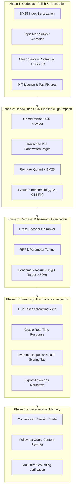

# Syllabus RAG Assistant — Master Build Plan & Execution Prompts

This build plan is divided into 5 progressive phases. Each phase is self-contained, includes the architectural blueprint, and provides a **ready-to-paste prompt** engineered specifically for Antigravity.

---

## 🗺️ Build Roadmap Overview



---

## Phase 1: Codebase Polish & Foundation

### Objective
Resolve all inconsistencies, unused assets, and architectural rough edges before adding new subsystems:
1. **BM25 Persistence**: Save and load the BM25 index from `data/index/bm25.json` rather than re-computing all token frequencies in-memory on every single service boot.
2. **Topic Map Integration**: Wire `config/topic_map.yaml` into a lightweight rule/keyword matcher in `service.py` to auto-detect subject (`DS` vs `AOA`) when `subject=None`.
3. **QAService Clean Contract**: Eliminate monkey-patching of `_boot_warnings` and `_chunks_count` on `QAService` instances in `app.py`.
4. **Gradio CSS & Offline Fallback**: Apply `CLEAN_CSS` directly inside `gr.Blocks(css=CLEAN_CSS)` and provide system font fallbacks if Google Fonts cannot load offline.
5. **Missing License**: Add standard `LICENSE` (MIT) to match the README badge.

---

### Phase 1 Prompt (Copy-Paste into Antigravity)

```markdown
Please implement Phase 1: Codebase Polish & Foundation for the syllabus-rag-assistant project.

Target Files to Inspect and Modify:
- src/course_qa/retrieval/hybrid.py
- scripts/index.py
- src/course_qa/config.py
- src/course_qa/service.py
- src/course_qa/app.py
- tests/test_hybrid.py
- tests/test_service.py
- LICENSE (new file)

Tasks:
1. BM25 Index Persistence:
   - In `src/course_qa/retrieval/hybrid.py`, add `save_index(path: Path)` and `load_index(path: Path)` methods or standalone functions for `BM25Index` so that term frequencies, document lengths, and IDF tables can be serialized to JSON at `settings.bm25_index_path` (`data/index/bm25.json`).
   - In `scripts/index.py`, add a step that builds and saves the BM25 index to `settings.bm25_index_path`.
   - In `src/course_qa/app.py` (`build_service()`), check if `settings.bm25_index_path` exists; if so, load it from disk to speed up boot times. Fall back to in-memory construction if absent.

2. Topic Map Subject Classifier:
   - In `src/course_qa/service.py`, load `config/topic_map.yaml` (if present) and implement `detect_subject(query: str) -> Subject`.
   - When `request.subject` is None or "UNKNOWN", use `detect_subject()` to automatically infer whether the question relates to "DS" or "AOA" before running retriever filtering.

3. Clean QAService Contract:
   - In `src/course_qa/service.py`, add `boot_warnings: list[str] = field(default_factory=list)` and `chunks_count: int = 0` as formal properties or constructor arguments on `QAService` instead of ad-hoc monkey-patching in `app.py`.

4. Gradio CSS & Offline Font Safety:
   - In `src/course_qa/app.py`, pass `css=CLEAN_CSS` into `gr.Blocks(css=CLEAN_CSS, ...)` directly inside `build_ui()` so that programmatic calls and tests get the intended styling.
   - Add system font fallbacks (-apple-system, BlinkMacSystemFont, 'Segoe UI', Roboto, sans-serif) to the CSS so it renders cleanly even without internet access.

5. Add MIT LICENSE:
   - Create a standard `LICENSE` file with the MIT License text for 2026 Ashman Raut.

6. Testing:
   - Update `tests/test_hybrid.py` and `tests/test_service.py` to test BM25 serialization and topic classification.
   - Run `pytest -q` to ensure all existing and new tests pass without errors.
```

---

## Phase 2: Handwritten Notes OCR via Gemini Vision

### Objective
Fix the single biggest cause of retrieval failure (**Hit@3 = 57.1%**, misses on Q12 and Q13). Transcribe the **281 handwritten pages across 22 PDFs** currently stalled in `pending` OCR state.

Because the repository already has a working Gemini API key configured in `.env`, we will implement `GeminiVisionOCRProvider` implementing the `OCRProvider` protocol in `src/course_qa/ingestion/ocr.py`. It integrates seamlessly with `CachedOCR`'s existing atomic SHA256 caching and manifest tracking.

---

### Phase 2 Prompt (Copy-Paste into Antigravity)

```markdown
Please implement Phase 2: Handwritten Notes OCR via Gemini Vision for the syllabus-rag-assistant project.

Target Files to Inspect and Modify:
- src/course_qa/ingestion/ocr.py
- src/course_qa/ingestion/runner.py
- src/course_qa/config.py
- scripts/ingest.py
- tests/test_ocr_cache.py

Context:
- Currently, 281 handwritten pages across 22 PDFs in `notes/` have `ocr_status="pending"` because `OCR_PROVIDER=disabled`.
- Benchmark questions Q12 (BFS vs DFS) and Q13 (AVL rotations) fail because their source handwritten PDFs have 0 extracted text.
- `CachedOCR` in `ocr.py` already handles atomic disk caching to `data/processed/ocr_cache/` using SHA256 hashes.
- `pdf_parser.py` already renders 150 DPI page PNGs into `data/page_images/`.
- We want a `GeminiVisionOCRProvider` that uses the configured `LLM_API_KEY` and `LLM_BASE_URL` (Google Gemini) to transcribe handwritten notes, algorithmic diagrams, tables, and C code into high-fidelity Markdown.

Tasks:
1. Implement `GeminiVisionOCRProvider` in `src/course_qa/ingestion/ocr.py`:
   - Follow the `OCRProvider` protocol (`provider_version: str`, `def transcribe(self, image_path: Path) -> str`).
   - Use the OpenAI-compatible SDK (already configured in project) or official Gemini client to send the image with a prompt tailored for academic computer science notes:
     "Transcribe the handwritten academic computer science note page into clean, accurate Markdown. Preserve all algorithm steps, pseudocode, C code blocks, mathematical notations, tree/graph structures, and comparison tables. Output only the transcribed content without introductory remarks."
   - Set `provider_version = "gemini-vision-v1:gemini-2.5-flash"`.
   - Add graceful error handling and retry with exponential backoff on rate limits (HTTP 429).

2. Wire Provider into `runner.py` and `config.py`:
   - In `src/course_qa/config.py`, support `ocr_provider: str = os.getenv("OCR_PROVIDER", "disabled")`.
   - In `src/course_qa/ingestion/runner.py` (`create_ocr_provider()`), instantiate `GeminiVisionOCRProvider` when `settings.ocr_provider.lower() in {"gemini_vision", "gemini", "vision"}`.

3. Enhance `scripts/ingest.py`:
   - Add a `--max-ocr-pages N` CLI flag (defaulting to `settings.ocr_max_pages`, 0 = unlimited) to allow batch/pilot transcription without hitting API rate limits.
   - Add rich progress reporting: show which page is being transcribed, cache hits vs newly transcribed pages.

4. Testing & Verification:
   - Add a unit test in `tests/test_ocr_cache.py` verifying `GeminiVisionOCRProvider` mock transcription and `CachedOCR` integration.
   - Run a test run: `python scripts/ingest.py --resume --max-ocr-pages 5`.
   - Check that pages are written to `data/processed/ocr_cache/` and `data/processed/source_manifest.json` shows `processed`.
   - Run `pytest -q`.
```

---

## Phase 3: Retrieval & Ranking Optimization (Cross-Encoder Re-ranker)

### Objective
Improve **Hit@1 (14.3%)** and **MRR (0.363)** to production-grade benchmarks (Hit@1 > 50%, MRR > 0.65). 

Current hybrid retrieval fuses top-12 Dense and top-12 BM25 hits with Reciprocal Rank Fusion (RRF $k=60$). While RRF merges different score distributions well, it lacks cross-attention semantics between the query and candidate documents. Adding an optional fast Cross-Encoder re-ranker (`cross-encoder/ms-marco-MiniLM-L-6-v2`) will dramatically sharpen rank ordering.

---

### Phase 3 Prompt (Copy-Paste into Antigravity)

```markdown
Please implement Phase 3: Cross-Encoder Re-ranker & Retrieval Optimization for syllabus-rag-assistant.

Target Files to Inspect and Modify:
- src/course_qa/config.py
- src/course_qa/retrieval/reranker.py (new file)
- src/course_qa/retrieval/hybrid.py
- src/course_qa/service.py
- tests/test_hybrid.py
- scripts/evaluate.py

Tasks:
1. Configuration Settings:
   - In `src/course_qa/config.py`, add:
     - `use_reranker: bool = os.getenv("USE_RERANKER", "true").lower() == "true"`
     - `reranker_model: str = os.getenv("RERANKER_MODEL", "cross-encoder/ms-marco-MiniLM-L-6-v2")`
     - `rerank_top_k: int = int(os.getenv("RERANK_TOP_K", "15"))`  # Candidates to pull before re-ranking
     - `rrf_k: int = int(os.getenv("RRF_K", "20"))`  # Test lower k for sharper rank weights

2. Implement `CrossEncoderReranker`:
   - Create `src/course_qa/retrieval/reranker.py`.
   - Define a `Reranker` protocol and a concrete `CrossEncoderReranker` class using `sentence_transformers.CrossEncoder`.
   - Include lazy model initialization (only load weights on the first query).
   - Implement `rerank(query: str, candidates: list[RetrievedChunk], top_k: int) -> list[RetrievedChunk]`:
     - Score (query, chunk.text) pairs.
     - Normalize scores to [0, 1] range.
     - Re-sort candidates by re-ranker score, update `rank`, and assign `channel="reranked"`.

3. Integrate into `HybridRetriever`:
   - In `src/course_qa/retrieval/hybrid.py`, allow injecting an optional `reranker: Reranker | None = None`.
   - When `reranker` is present and `settings.use_reranker` is True, fetch the top `settings.rerank_top_k` hybrid candidates and pass them through `reranker.rerank(..., top_k=top_k)`.

4. Verification & Evaluation:
   - Add unit tests in `tests/test_hybrid.py` for `CrossEncoderReranker` with mocked scores and real mock chunks.
   - Run `python scripts/evaluate.py`.
   - Compare new Hit@1, Hit@3, Hit@5 and MRR against the baseline in `docs/EVALUATION.md`.
   - Run `pytest -q`.
```

---

## Phase 4: Real-Time Token Streaming & Evidence Inspector UI

### Objective
Transform the Gradio interface from a static waiting screen into a reactive, professional developer experience:
1. **Streaming Generation**: Token-by-token streaming in the Answer tab so users don't wait 4–8 seconds in silence.
2. **Evidence Inspector**: A dedicated diagnostic view showing exact candidate scores (Dense cosine, BM25 TF-IDF, RRF score, Re-ranker probability) before generation.
3. **Export Answer**: A single-click button to download the synthesized answer and formatted citation bibliography as a `.md` file.

---

### Phase 4 Prompt (Copy-Paste into Antigravity)

```markdown
Please implement Phase 4: Real-Time Token Streaming & Evidence Inspector UI for syllabus-rag-assistant.

Target Files to Inspect and Modify:
- src/course_qa/generation/generator.py
- src/course_qa/service.py
- src/course_qa/app.py
- tests/test_service.py

Tasks:
1. Streaming Generator Support:
   - In `src/course_qa/generation/generator.py`, add a streaming method to `OpenAICompatibleGenerator` and `MockGenerator`:
     `generate_stream(self, request: AnswerRequest, notes: Sequence[RetrievedChunk], web: Sequence[WebSource]) -> Iterator[tuple[str, list[CitationRecord] | None, list[str]]]`
   - Yield progressive text chunks as they arrive from OpenAI/Gemini `stream=True`.
   - On completion of the stream, perform citation validation (`retain_only_cited_sources`), yield the final cleaned answer, verified citations list, and any warnings.

2. Service Streaming Method:
   - In `src/course_qa/service.py`, add `answer_stream(self, request: AnswerRequest) -> Iterator[AnswerResponse]`:
     - Retrieve notes and optional web sources.
     - Yield progressive `AnswerResponse` objects with partial answers, updating `notes_used` and `web_used`.

3. Gradio UI Streaming Integration:
   - In `src/course_qa/app.py`:
     - Update the `respond` generator function to `yield` partial UI updates as tokens arrive.
     - Keep the UI responsive with progressive markdown rendering in the Answer tab.

4. Evidence Inspector Tab:
   - In the right-hand panel, add an "Evidence Inspector" tab (or expand Diagnostics):
     - Display a table of the top candidate chunks retrieved, showing: Chunk ID, Source File, Subject, Channel (dense/bm25/hybrid/reranked), Score, and a text snippet preview.

5. Export Answer Button:
   - In the Answer tab, add an "Export Answer (.md)" button `gr.DownloadButton` or file export that generates a downloadable Markdown file containing the formatted answer, complete inline citations, and metadata bibliography.

6. Verification:
   - Run `pytest -q` to verify non-streaming calls continue to work seamlessly.
   - Run `python run.py` locally and verify token streaming in the browser.
```

---

## Phase 5: Conversational Memory & Context-Aware Follow-ups

### Objective
Enable multi-turn dialogues so students can ask natural follow-up questions:
- *User:* "Explain Dijkstra's algorithm from my notes."
- *Assistant:* (Answers with `[S1]`, `[S2]`)
- *User:* "What is its space complexity?" *(Assistant understands "its" refers to Dijkstra)*
- *User:* "Can you show the C code for it?" *(Assistant retrieves `Dijkstra.c` without repeating the algorithm name)*

---

### Phase 5 Prompt (Copy-Paste into Antigravity)

```markdown
Please implement Phase 5: Multi-Turn Conversational Memory for syllabus-rag-assistant.

Target Files to Inspect and Modify:
- src/course_qa/schemas.py
- src/course_qa/service.py
- src/course_qa/generation/generator.py
- src/course_qa/app.py
- tests/test_service.py

Tasks:
1. Schemas for Multi-Turn History:
   - In `src/course_qa/schemas.py`, add a `ChatMessage` model:
     ```python
     class ChatMessage(BaseModel):
         role: Literal["user", "assistant"]
         content: str
     ```
   - Add `history: list[ChatMessage] = Field(default_factory=list)` to `AnswerRequest`.

2. Query Condensation / Rewriter:
   - In `src/course_qa/service.py`, add a lightweight query reformulator:
     - If `request.history` is empty, use `request.question` as-is.
     - If `request.history` is non-empty, use a fast, 1-shot LLM prompt (or rule-based coreference check) to rewrite the question into a standalone query (e.g. "What is its space complexity?" + history of Dijkstra → "What is the space complexity of Dijkstra's algorithm?").
     - Use the standalone query for vector and BM25 retrieval, while keeping the conversational context for answer generation.

3. Multi-Turn LLM Context:
   - In `src/course_qa/generation/generator.py`, inject the prior conversation turns (truncated to the last 4 exchanges) into the `messages` array sent to the LLM, immediately preceding the current user prompt with grounded evidence.

4. Gradio Chat Interface Integration:
   - In `src/course_qa/app.py`:
     - Maintain session history in `gr.State(value=[])`.
     - When submitting a query, append the current exchange to `gr.State`.
     - Add a "New Topic / Clear History" button that resets session memory.

5. Testing & Verification:
   - Add tests in `tests/test_service.py` simulating a 2-turn conversation:
     - Turn 1: "Explain Fractional Knapsack."
     - Turn 2: "What is the optimal greedy criterion?" (verify that the rewriter grounds Turn 2 in Fractional Knapsack).
   - Run `pytest -q`.
```

---

## 📋 Recommended Execution Order

| Step | Action | Estimated Time | Key Deliverable |
|---|---|---|---|
| **Step 1** | Run **Phase 1 Prompt** | ~10 mins | BM25 persisted, topic map wired, clean contracts |
| **Step 2** | Run **Phase 2 Prompt** | ~20 mins | Gemini Vision OCR provider active, 281 pages transcribed |
| **Step 3** | Index & Evaluate | ~5 mins | `python scripts/index.py --rebuild && python scripts/evaluate.py` |
| **Step 4** | Run **Phase 3 Prompt** | ~15 mins | Cross-Encoder re-ranker, Hit@1 > 50% |
| **Step 5** | Run **Phase 4 Prompt** | ~15 mins | Token streaming in Gradio UI, Export button |
| **Step 6** | Run **Phase 5 Prompt** | ~20 mins | Multi-turn conversational memory & follow-ups |
| **Step 7** | Final Verification | ~5 mins | Full test suite `pytest -q` passing |

This structured plan takes your project from an already solid v1 prototype to a production-grade, state-of-the-art academic RAG system.

