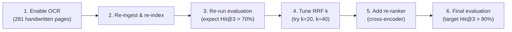

# Syllabus RAG Assistant — Next Steps

## Current State Summary

Your project is a **fully functional** syllabus-grounded QA assistant for DS and AOA courses. The core pipeline — ingestion → hybrid retrieval (Qdrant dense + BM25 with RRF) → LLM generation → citation validation → Gradio UI — is complete and working. You have **106 passing tests**, 575 indexed chunks, and a 15-question benchmark evaluated.

> [!NOTE]
> All four contributor branches (ingestion, retrieval, generation, UI) have been merged to `main`. The integration checklist is fully checked off. This is a solid v1 that's demo-ready.

---

## Key Gaps to Address

### 🔴 Priority 1: Handwritten OCR (Biggest Impact on Retrieval)

Your evaluation shows **Hit@3 = 57.1%** and **MRR = 0.363** — both below target. The root cause is clear: **281 handwritten pages across 22 PDFs are not transcribed** (Q12 and Q13 both miss). This is the single biggest improvement lever.

**What to do:**
1. Enable the `PaddleOCRVLProvider` already scaffolded in [`ocr.py`](file:///Users/ashmanraut/Ashman/Fr.%20CRCE/NLP/syllabus-rag-assistant/src/course_qa/ingestion/ocr.py#L54-L100) — set `OCR_PROVIDER=paddleocr_vl` in `.env`
2. Install PaddleOCR dependencies (you may need a `requirements-ocr.txt`)
3. Run `python scripts/ingest.py --resume` to transcribe the 281 pending pages
4. Re-index with `python scripts/index.py --rebuild`
5. Re-run `python scripts/evaluate.py` — expect Hit@3 to jump significantly since Q12 (BFS vs DFS) and Q13 (AVL rotations) would now have actual text to match against

**Alternatively**, if PaddleOCR is too heavy, consider using the Gemini Vision API (you already have a Gemini key configured) to transcribe handwritten pages via a new OCR provider class.

---

### 🟡 Priority 2: Retrieval Quality Improvements

Even with OCR, your **Hit@1 = 14.3%** suggests the ranking needs tuning:

| Improvement | Effort | Impact |
|---|---|---|
| **Tune RRF k parameter** — currently `k=60` (default). Try `k=20` or `k=40`; lower values weight top-ranked results more aggressively | Low | Medium |
| **Add query expansion / rewriting** — use the LLM to rephrase the user query before retrieval (e.g., "fractional knapsack greedy" → also search "profit weight ratio knapsack") | Medium | High |
| **Upgrade embedding model** — `all-MiniLM-L6-v2` (384d) is fast but small. Consider `all-mpnet-base-v2` (768d) or a domain-tuned model | Low | Medium |
| **Add chunk overlap** — check if your PDF splitter uses overlapping windows; non-overlapping chunks lose context at boundaries | Low | Medium |
| **Re-ranker stage** — add a cross-encoder re-ranker (e.g., `cross-encoder/ms-marco-MiniLM-L-6-v2`) between RRF and generation | Medium | High |

---

### 🟡 Priority 3: DS Typed Notes Gap

Your scanner's `FOLDER_MAP` in [`scanner.py`](file:///Users/ashmanraut/Ashman/Fr.%20CRCE/NLP/syllabus-rag-assistant/src/course_qa/ingestion/scanner.py#L10-L26) maps `DS notes/Typed` but the evaluation report notes **"zero typed notes in DS"** as a known limitation. Either:
- Add typed DS PDFs to `notes/ds_notes/Typed/` if you have them
- Or explicitly acknowledge this in the UI ("DS answers draw primarily from C code implementations and handwritten notes")

---

### 🟢 Priority 4: Production Hardening & Code Quality Fixes

These are straightforward improvements for a more polished project:

1. **BM25 index persistence is broken** — [`config.py`](file:///Users/ashmanraut/Ashman/Fr.%20CRCE/NLP/syllabus-rag-assistant/src/course_qa/config.py#L37) defines `bm25_index_path` pointing to `data/index/bm25.json`, and the README mentions it, but **no code ever saves or loads it**. BM25 is rebuilt in-memory from `chunks.jsonl` on every boot. Either implement save/load in [`hybrid.py`](file:///Users/ashmanraut/Ashman/Fr.%20CRCE/NLP/syllabus-rag-assistant/src/course_qa/retrieval/hybrid.py) or remove the config setting and fix the README.

2. **`topic_map.yaml` is unused** — [`config/topic_map.yaml`](file:///Users/ashmanraut/Ashman/Fr.%20CRCE/NLP/syllabus-rag-assistant/config/topic_map.yaml) contains DS/AOA topic lists but is **never imported or referenced** in any code. This was likely planned for automatic subject classification from query text. Either integrate it into `should_search_web()` / subject routing logic, or remove it.

3. **Missing LICENSE file** — The README claims MIT License and links to `LICENSE`, but **no LICENSE file exists** in the repo. Create one.

4. **Monkey-patched attributes on `QAService`** — In [`app.py` lines 175-177](file:///Users/ashmanraut/Ashman/Fr.%20CRCE/NLP/syllabus-rag-assistant/src/course_qa/app.py#L175-L177), `_boot_warnings` and `_chunks_count` are set as ad-hoc attributes on the service instance after construction. These should be declared in `QAService.__init__()` or passed separately.

5. **CSS not applied when `build_ui()` is called directly** — The custom `CLEAN_CSS` is passed in `main()` via `demo.launch(css=...)`, but `build_ui()` creates the Blocks without it. Anyone calling `build_ui()` programmatically (or tests) gets an unstyled UI. Move `css=CLEAN_CSS` into the `gr.Blocks(...)` constructor.

6. **CSS font loading** — [`CLEAN_CSS`](file:///Users/ashmanraut/Ashman/Fr.%20CRCE/NLP/syllabus-rag-assistant/src/course_qa/app.py#L22-L129) imports Google Fonts via `@import url(...)`. This requires network access; add a local fallback for the offline/Ollama use case.

7. **`.gitignore` cleanup** — The integration checklist warns never to commit `.env`, page images, `chunks.jsonl`, or Qdrant storage. Verify your `.gitignore` covers all of these.

8. **Error handling in `app.py`** — the [`build_service()`](file:///Users/ashmanraut/Ashman/Fr.%20CRCE/NLP/syllabus-rag-assistant/src/course_qa/app.py#L132-L178) function raises `RuntimeError` if chunks aren't found. Consider a graceful degraded UI that tells the user to run ingestion.

---

### 🟢 Priority 5: Feature Enhancements

| Feature | Description |
|---|---|
| **Conversation memory** | Currently stateless — each question is independent. Add session-level context so follow-up questions work ("What about its space complexity?" after asking about Dijkstra) |
| **Streaming responses** | The Gradio UI waits for the full LLM response. Use `stream=True` in the OpenAI client and `gr.Markdown` streaming for better UX |
| **Multi-subject support** | Extend beyond DS/AOA — the architecture generalizes well. Just add new folders to `FOLDER_MAP` and re-ingest |
| **Tree-sitter for C parsing** | [`code_parser.py`](file:///Users/ashmanraut/Ashman/Fr.%20CRCE/NLP/syllabus-rag-assistant/src/course_qa/ingestion/code_parser.py) uses regex brace-matching. A comment in the file notes "Tree-sitter can replace this behind the same interface" — this would handle edge cases (nested braces in strings, macros) more robustly |
| **Docling for complex PDFs** | `requirements-docling.txt` exists with `docling>=2.0` but no code uses it. The comment says "use when typed PDF extraction from pypdf mangles reading order, tables, or equations." Worth integrating if you add notes with complex formatting |
| **Evaluation automation** | Wire `scripts/evaluate.py` into CI (GitHub Actions) so retrieval metrics are tracked on every commit |
| **Export answers** | Add a "Copy as Markdown" or "Export as PDF" button for students preparing exam notes |
| **Chunk visualization** | Add a debug tab showing which chunks were retrieved, their RRF scores, and which channel (dense/BM25) contributed each |

---

## Suggested Immediate Action Plan

> [!TIP]
> The highest ROI action is **enabling OCR for handwritten notes** — it directly addresses 3 of the 4 missed queries in your benchmark and could push Hit@5 from 78.6% past the 85% target with zero architectural changes.

